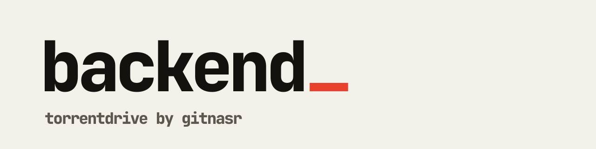

<picture>
  <source media="(prefers-color-scheme: dark)" srcset=".github/banner-dark.svg">
  
</picture>

[Documentation](https://tc.gitnasr.com/docs) · [Website](https://tc.gitnasr.com) · [Container image](https://github.com/TorrentDrive/backend/pkgs/container/torrentdrive) · [MIT License](LICENSE)

The core backend service for [TorrentDrive](https://tc.gitnasr.com) — an open-source, self-hosted torrent-to-Google Drive and S3 cloud downloader.

Built with **.NET 9**, **Clean Architecture**, **MonoTorrent**, and **Hangfire**, this repository contains the REST API, background download workers, Google Drive & S3 upload workers, the unified all-in-one container image, and 1-click deployment blueprints for Dokploy, Coolify, Railway, and Render.

> **Just want to run it?**
>
> <!-- snippet:install-linux -->
> ```bash
> curl -fsSL https://raw.githubusercontent.com/TorrentDrive/backend/main/install.sh | bash
> ```
> <!-- /snippet -->
>
> Or run `docker compose up -d` from the root of this repository.
> Full documentation: **[tc.gitnasr.com/docs](https://tc.gitnasr.com/docs)**

---

## What lives in this repo

Clean Architecture, so the domain does not depend on frameworks or databases, plus the zero-config all-in-one container and PaaS blueprints.

```
TorrentDrive.sln
├── TorrentDrive.Core/                 # Domain entities, interfaces, enums, options
├── TorrentDrive.Application/          # Use cases, DTOs, validators
├── TorrentDrive.Infrastructure/       # EF Core, Redis, Hangfire, external clients
├── TorrentDrive.API/                  # ASP.NET Core controllers, middleware, DI
├── TorrentDrive.Worker/               # Torrent downloads (MonoTorrent + MSE/PE RC4)
├── TorrentDrive.GoogleDrive.Worker/   # Google Drive streaming uploads (OAuth 2.0)
├── TorrentDrive.S3.Worker/            # S3 checkpointed multipart uploads (AWS, R2, B2)
├── Dockerfile                         # Unified all-in-one container image
├── docker-compose.yml                 # Zero-config single-command stack
├── compose/                           # Split, dev, and local-build compose topologies
└── paas/                              # 1-click blueprints (Dokploy, Coolify, Render, Railway)
```

**Dependency flow:** `API / Workers` → `Application` → `Core` ← `Infrastructure`

Each worker is an independent process sharing the same PostgreSQL and Redis as the API, pulling from its own Hangfire queue (`torrents`, `googledrive`, `s3`), and scalable on its own.

---

## Developing

Requires the [.NET 9 SDK](https://dotnet.microsoft.com/download/dotnet/9.0) and [Docker](https://docs.docker.com/get-docker/).

```bash
git clone https://github.com/TorrentDrive/backend.git
cd backend
docker compose -f compose/docker-compose.local-build.yml up -d postgres redis
dotnet run --project TorrentDrive.API
```

The API listens on `http://localhost:47200`. No `.env` is needed — compose and the app both fall back to working development defaults. Copy `.env.example` to `.env` only if you want to override something.

Workers run the same way, in their own terminals:

```bash
dotnet run --project TorrentDrive.Worker
dotnet run --project TorrentDrive.GoogleDrive.Worker
dotnet run --project TorrentDrive.S3.Worker
```

The API reference and every configuration key are documented at [tc.gitnasr.com/docs](https://tc.gitnasr.com/docs) — they are generated from this code, so they are not restated here.

---

## Repositories

| Repository | Contents |
|------------|----------|
| [backend](https://github.com/TorrentDrive/backend) | .NET 9 API, workers, all-in-one image, installer, and PaaS blueprints |
| [frontend](https://github.com/TorrentDrive/frontend) | Next.js web app |
| [website](https://github.com/TorrentDrive/website) | Documentation site — the canonical docs live here |

---

## License

MIT — see [LICENSE](https://github.com/TorrentDrive/backend/blob/main/LICENSE).
